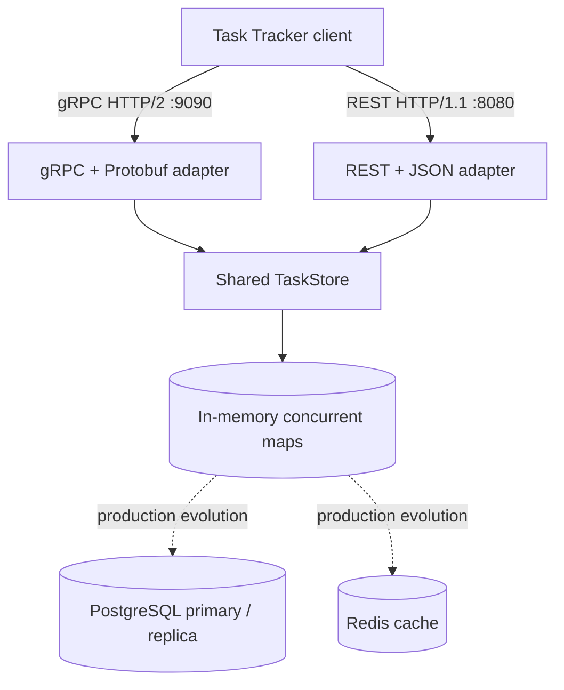
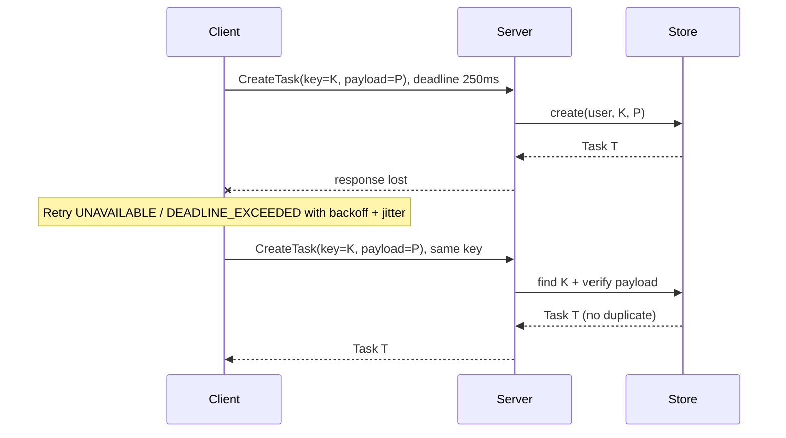

# SIS #2 — To-Do / Task Tracker API (Java, gRPC/HTTP-2 vs REST/JSON)

[](https://openjdk.org/) [](https://maven.apache.org/)

An educational protocol implementation for **T3: To-Do / Task Tracker API**. SIS #1 target: **2,000 RPS peak** (80% reads, 20% writes), **1 million users**, **p99 < 100 ms**. These are **design targets**, not measured results of this single-instance demonstrator.

## 1. Protocol decision

- **Primary: gRPC over HTTP/2, Protocol Buffers**. Compact binary schema, typed generated Java interfaces, persistent multiplexed HTTP/2 transport and built-in per-call deadlines.
- **Baseline: REST/JSON over HTTP/1.1** using Java's built-in `HttpServer`, sharing the **same task service** and in-memory data. This deliberately isolates serialization/transport differences as much as possible.
- WebSocket is not selected: the core task use case is request/response CRUD rather than continuous server push; optional notifications could be implemented separately.

## 2. Functional contract

A task has `id`, `userId`, `title`, `description`, `status` (`TODO`, `IN_PROGRESS`, `DONE`), `priority` (0–5), optional ISO-8601 UTC `dueAt`, `createdAt`, `updatedAt`, and `version`.

| Operation | gRPC | REST/JSON | Notes |
|---|---|---|---|
| Create | `CreateTask` | `POST /api/v1/tasks` | Requires stable `idempotency-key` header |
| Read | `GetTask` | `GET /api/v1/tasks/{id}` | Tenant-scoped |
| Filter/list | `ListTasks` | `GET /api/v1/tasks?status=TODO&due_before=...&limit=50&cursor=...` | Sorted by id, cursor-based; limit max 100 |
| Update | `UpdateTask` | `PUT /api/v1/tasks/{id}` | Full replacement; `expected_version` / `If-Match` |
| Delete | `DeleteTask` | `DELETE /api/v1/tasks/{id}` | Second delete returns not found |

**Intentional SIS #1 adaptation:** REST baseline uses full-replacement `PUT` rather than partial `PATCH`, because the provided gRPC update message is a full replacement. Production SIS #1 uses soft deletion; this minimal demo removes tasks physically. These differences must be resolved before a production deployment.

**Auth caveat:** For local development, provide `x-user-id` (gRPC metadata) or `X-User-Id` (REST header). This is a **trusted test identity**, NOT authentication. Do **not** expose this server to the internet. In a real deployment validate JWT at an API gateway or interceptor and derive the principal server-side, enforce tenant ownership and use TLS/mTLS.

## 3. Architecture



**Production scaling (from SIS #1):** horizontal stateless gRPC instances behind a load balancer; PostgreSQL with (user_id, status, due_at, id) index, read replicas where consistency permits; Redis cache-aside for hot task reads. Demo uses one process and non-durable maps, so it is **not** a production-grade 2,000-RPS / 1-million-user demonstration. See `docs/architecture.mmd`.

## 4. Idempotency + timeouts + retries



- Idempotency namespace: `(userId, idempotencyKey)`; same key + same content returns **the same task**. Same key + altered content gives conflict. In this demo, the key registry persists only for the process lifetime and is not TTL bounded. Production implementation requires transactional durable storage, request hash, TTL and atomic uniqueness constraints.
- **Per-attempt deadline:** `RetryingTaskClient` sets 250 ms on the gRPC call; total execution can exceed 250 ms because it performs up to three attempts. Set a separate overall user-request deadline in production.
- **Retries:** maximum 3 attempts, only `UNAVAILABLE` or `DEADLINE_EXCEEDED`, exponential backoff (25ms, 50ms) with 0–14ms jitter. Do not retry validation, missing, or version-conflict responses. Writes are retryable **only** with a stable idempotency key.
- **Optimistic concurrency:** update requires a matching version; successful update increments it. A stale expected version fails with conflict; the client should reload the task before modifying it.
- **Delete:** non-idempotent error semantics on repeated delete (`NOT_FOUND`); a production retry policy should handle DELETE separately (e.g., idempotent delete response or durable tombstone).

## 5. Run locally

Prerequisites: **JDK 21** and **Apache Maven 3.9+**. Maven generates gRPC/Protobuf Java classes during `compile`. No hand-written generated sources in Git.

```bash
mvn clean test
mvn -q exec:java -Dexec.mainClass=com.example.tasktracker.api.TaskServer
```

Server listens on `localhost:9090` (gRPC, plaintext HTTP/2) and `localhost:8080` (REST, HTTP/1.1). **Use locally only:** the demo binds all interfaces and uses untrusted identity headers and no TLS.

In another terminal:

```bash
curl -s -X POST http://localhost:8080/api/v1/tasks \
  -H 'Content-Type: application/json' \
  -H 'X-User-Id: demo-user' \
  -H 'Idempotency-Key: demo-123' \
  -d '{"title":"Submit SIS #2","description":"Protocol implementation","status":"TODO","priority":2,"dueAt":"2026-12-01T12:00:00Z"}'

curl -s -H 'X-User-Id: demo-user' \
  'http://localhost:8080/api/v1/tasks?status=TODO&limit=10'
```

The gRPC interface is defined in `src/main/proto/tasks.proto`. You can inspect with `grpcurl` or invoke `RetryingTaskClient` from another Java application. No gRPC reflection endpoint is enabled.

## 6. Benchmark: actual results, no invented numbers

Start the server, then run in another terminal:

```bash
mvn -q exec:java -Dexec.mainClass=com.example.tasktracker.benchmark.ProtocolBenchmark -Dexec.args="1000 200"
cat benchmark-results/latest.csv
```

This creates one task via gRPC, then alternates **200 warmup GETs per protocol**; it measures **1,000 sequential GETs per protocol**. Both protocols read the **identical task in the shared service**. The benchmark writes the result to `benchmark-results/latest.csv` with columns:

`protocol,samples,p50_us,p95_us,p99_us,avg_payload_bytes`

- **Latency:** wall-clock round trip using `System.nanoTime()` (same host, persistent client connections; includes local networking and deserialization, excludes service startup and warmup).
- **Payload:** gRPC `TaskReply.getSerializedSize()` versus REST UTF-8 response-body byte length. **This does not measure total wire traffic**, including HPACK, HTTP/2 frame headers, HTTP/1.1 headers or TLS.
- **Fairness:** the two adapters share identical task records, but gRPC has HTTP/2 while REST uses HTTP/1.1, and protobuf/JSON processing differs; sequential loops can have JIT/GC/order bias. Repeat runs, vary order, fix CPU load and report environment.
- **Limits:** no concurrent workers, no TLS, no database, no Redis, no representative users. This benchmark **cannot validate the 2,000 RPS target or p99 < 100ms under load**. Add Gatling/k6/ghz load tests and real database for that objective.

**Example report to fill after execution:**

| Protocol | Samples | p50 (µs) | p95 (µs) | p99 (µs) | Avg body size (bytes) |
|---|---:|---:|---:|---:|---:|
| gRPC/Protobuf | `latest.csv` | `latest.csv` | `latest.csv` | `latest.csv` | `latest.csv` |
| REST/JSON | `latest.csv` | `latest.csv` | `latest.csv` | `latest.csv` | `latest.csv` |

## 7. Failure behavior

| Failure | Behavior |
|---|---|
| Response lost after create | Retry with same key returns original task |
| Client timeout / transient server outage | Bounded retry on transient gRPC status only |
| Concurrent update | Expected version mismatch -> conflict |
| Wrong user ID for existing task | Not found (prevents revealing another user's task) |
| Server restart | In-memory tasks **and idempotency history are lost** (demo limitation) |
| Malformed task input | Reject; do not retry |
| Database/Redis unavailable | Not implemented in demo; SIS #1 describes DB failover and cache fallback |

## 8. Tests and code organization

```text
src/main/proto/tasks.proto                 # Public protobuf contract
src/main/java/com/example/tasktracker/
  api/TaskServer.java                     # Starts both adapters
  core/Task.java, TaskInput.java          # Immutable domain records
  core/TaskStore.java, TaskException.java # Shared logic + checks
  grpc/GrpcTaskEndpoint.java              # Generated-stub implementation
  rest/RestTaskEndpoint.java              # REST/JSON baseline
  client/RetryingTaskClient.java          # Deadline + retries
  benchmark/ProtocolBenchmark.java        # p50/p95/p99, body bytes, CSV
src/test/java/.../TaskStoreTest.java       # Idempotency, version, tenants, filters
```

Style: named classes and methods, limited responsibilities, Java records for data, explicit error mapping, no deeply nested function-chaining patterns. Add Spotless/Checkstyle and CI before treating this as a production codebase.

## 9. Submission checklist

1. Push the whole folder to GitHub. Do **not** commit `target/` generated Java classes.
2. Run `mvn clean test` and include proof of tests in your presentation.
3. Run the benchmark on your machine and commit a **copy** of measured CSV with a descriptive filename (e.g., `benchmark-results/macbook-2026-10-30.csv`) and environment notes.
4. Explain the **single-store demo vs production PostgreSQL/Redis** distinction, gRPC selection, retry cases and why p99 numbers measured locally do not certify 2,000 RPS.
5. Show the Mermaid diagrams rendered in the GitHub README and demonstrate two calls reusing the same idempotency key.
